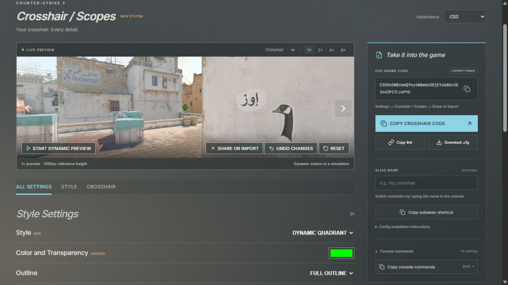

# CS2 Crosshair Studio

[delli.cc](https://delli.cc/) is a browser editor for the current Counter-Strike 2 crosshair system. Choose a style, adjust its settings, and copy a share code into the game. You can also download a config or save crosshairs in a local library.



## Use the editor

1. Choose one of the ten crosshair styles or import a code through **Share or Import**.
2. Adjust color, opacity, outline, thickness, gap, and the controls available for that style.
3. Copy the crosshair code. In CS2, open **Settings → Crosshair / Scopes → Share or Import**, paste it, and import it.

The editor has Style Settings and Crosshair Settings. Gap controls accept values from -10 to 128. The preview offers seven game backgrounds, four zoom levels, a scope dot view, and simulated dynamic motion.

The preview draws the crosshair at the resolution it was made for, where one unit is one game pixel. If you play at another resolution, turn on **Match my in-game size** under Preview options to see how CS2 rounds and stretches it on your monitor. A crosshair too large for the preview is drawn smaller to fit, with a note giving the magnification shown. Use fullscreen to place the crosshair at the screen center. The detail view helps inspect arm and outline symmetry at 4×. A short intro plays at 1.25× speed on a browser's first visit (not with reduced motion) and fades into the editor. Later visits open the editor directly; add `?intro=preview` to the address to replay it.

Current `CS` codes carry crosshair and scope dot settings. Older `CSGO-` codes are supported with an approximation notice when conversion is needed. Config files and website links preserve additional settings. The import box finds a code or link inside other text, such as a chat message or a link without `https://`. It reads `.cfg` and `.txt` files, the game's `.vcfg` settings files, console `find crosshair` output and old CS:GO configs, and a library backup `.json` is merged into the library. Imported console commands are parsed as data; the website does not execute them, and settings inside `bind` or `alias` commands are skipped.

An optional alias such as `team_green` produces `crosshair_team_green.cfg` and this autoexec shortcut:

```cfg
alias team_green "exec crosshair_team_green.cfg"
```

Put the config in `Counter-Strike Global Offensive/game/csgo/cfg`. Add the shortcut to `autoexec.cfg`, then type `team_green` in the game console.

Downloaded configs include the share code, the commented alias shortcut, and a short usage note at the top. Remove the leading `//` when copying the alias into `autoexec.cfg`.

## Local storage and sharing

Drafts, preferences, aliases, feedback notes, up to 50 favorites, and up to 20 recent crosshairs stay in your browser. Use the library's JSON backup to save a copy elsewhere. Share links include settings in the URL, so anyone with the link can read them.

The editor works without an account and has no analytics. Optional Steam sign-in syncs saved crosshairs; see below. Fonts and map backgrounds are served with the site, and Vercel receives normal page requests. Opening an issue draft takes you to GitHub, where you can review the text before submitting it.

This replacement uses a separate `delli.v3` storage namespace. It does not automatically migrate the previous website's drafts or library. Old stored data is left in place. Legacy share-code links still work.

## Development

Use Node.js 24 and npm.

```sh
npm ci
npm run dev
```

Open `http://127.0.0.1:4180/`.

| Command | Purpose |
| --- | --- |
| `npm test` | Run codec, config, validation, and geometry tests |
| `npm run build` | Check TypeScript and build the static site into `dist` |
| `npm run check` | Run unit tests and the production build |
| `npx playwright install chromium` | Install the browser used by end-to-end tests |
| `npm run test:e2e` | Test the production build at desktop and mobile sizes |

## Verification and limits

The current codec was checked against CS2 1.41.8.8. All ten website-generated styles were imported through the running game's menu and re-exported as the exact same code. Browser tests cover editing, clipboard operations, downloads, imports, links, library actions, and preview controls.

The preview is a browser approximation. Dynamic movement, recoil, quadrant geometry, and scope rendering do not model every weapon or game state. Check your final crosshair in CS2. Earlier code conversion is approximate.

## Documentation

- [Architecture](docs/ARCHITECTURE.md)
- [Testing](docs/TESTING.md)
- [Display sizing](docs/DISPLAY_SCALING.md)
- [Raster symmetry](docs/RASTER_SYMMETRY.md)
- [Deployment and rollback](docs/DEPLOYMENT.md)
- [Share-code protocol](docs/PROTOCOL.md)
- [Third-party notices](docs/THIRD_PARTY.md)

GitHub Actions verifies changes on `main`. Vercel deploys the frontend and Steam/library API from the connected repository. Previous GitHub Pages configuration remains recoverable in Git history.

The project's source code is released under the [MIT License](LICENSE). Vendored third-party code keeps its own notices; see [third-party notices](docs/THIRD_PARTY.md). Counter-Strike, the map preview images and the intro video belong to Valve and are not covered by the MIT License. This project is independent and is not endorsed by Valve.

## Steam sign-in and private library sync

The editor works without an account. Pasted or chosen codes, links and configs apply immediately; the notice says what was imported, adjusted or skipped. Library is a main view with names or player nicknames, selected previews, direct code copying, backup and restore. Editing a saved crosshair creates a draft; use Update saved crosshair or Save as new explicitly.

For the complete local application, use Node.js 24 or newer:

```sh
npm run build
npm start
```

Open http://127.0.0.1:4181. This serves the frontend and Steam/library API from the same origin. Steam sign-in uses OpenID and does not require a Steam Web API key. Authentication happens on Steam; the app stores a private favorite library under the verified Steam identity. Only saved names and settings synchronize. Local drafts, recent imports, aliases, and appearance preferences do not.

The SQLite file is `data/library.sqlite`; preserve and back it up when deploying. Pending account changes are durably cached in browser storage and retried after connectivity returns. First login offers an explicit merge of the device's guest favorites; it never silently uploads them. Concurrent divergent edits retain both versions rather than silently overwriting one.

Production Steam login requires an HTTPS same-origin backend, supplied by Vercel Functions in the configured deployment or by the local Node service behind a reverse proxy. Set `PUBLIC_ORIGIN` to the exact stable public origin. Do not publish the SQLite file, environment files, or server sources as static assets. See [library sync](docs/LIBRARY_SYNC.md) for configuration, privacy, verification, and deployment details.

Vercel hosting is configured under the `softhe` team with separate Neon databases for preview and production. The Node API runs as Vercel Functions and keeps durable sessions and favorites in Postgres. See [Vercel deployment](docs/VERCEL_DEPLOYMENT.md) for environment setup, verification, and the boundary between the Vercel address and the existing `delli.cc` site.
