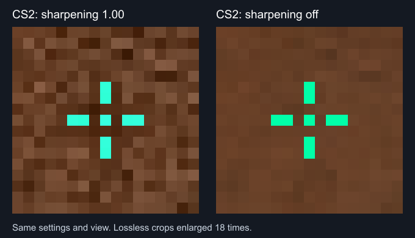

# Crosshair calibration and current-main integration

Updated October 27, 2026.

## Source baseline

The rendering work was resumed on `fix/game-crosshair-raster`. Current upstream main was `276a0b4`, including:

- `c16c960`, PR #18: analytic symmetric curve coverage, integer outline widths, fit scale reporting, layout changes and sync-rate-limit fixes.
- `5d955de`, PR #19: favicon assets.
- `276a0b4`, PR #20: automatic pasted-code and selected-file import.

The integration retains the newer coverage/compositing implementation and import behavior. Native raster magnification wraps that coverage implementation rather than restoring the older canvas-mask renderer.

## Implemented behavior

- New preview preferences default to an explicit 1080p game target. Presets, custom render height and optional monitor estimate remain separate from encoded crosshair settings. The browser cannot detect CS2's render resolution.
- Render at the selected native target before magnifying. Main zoom and the live 4x detail inset reuse the same raster frame. Integer magnification replicates pixels exactly, including alpha and outline coverage.
- The detail inset reports cropping and does not silently shrink a view labeled 4x. Fit can reduce main presentation scale. Extreme source dimensions have a bounded allocation limit and explicitly report incomplete source coverage.
- The measured nonnegative Static Cross path uses full gap units, independently rounded arm lengths and inner distances, and the captured odd/even center convention. Other styles and negative gaps retain their earlier approximate behavior.
- Current main's symmetric curve sampling and whole-pixel outlines are preserved.

## Game evidence

The lossless PNG window captures in `evidence/crosshair-calibration/` were collected through Computer Use during the October 25 session. The game was CS2 1.41.9.2, SourceRevision 11162119, in a 1920x1080 window. The captured client origin is (1,31) inside the 1922x1112 window image. Shape was Static Cross, length 2, center dot enabled and no outline; foreground settings were RGB 0,255,168 and alpha 255.

| Capture | Thickness | Gap | Input reference height | Measured foreground width |
| --- | ---: | ---: | ---: | ---: |
| baseline-original.png | 1 | 2 | 1080 | 7 px |
| thickness-2.png | 2 | 2 | 1080 | 8 px |
| thickness-3.png | 3 | 2 | 1080 | 7 px |
| thickness-2-gap-4.png | 2 | 4 | 1080 | 12 px |
| reference-810.png | 1 | 2 | 810 | 11 px |

`static-1080.png` duplicates the original baseline. `background.png` records the same wall with the crosshair disabled. Changing the reference height was followed by game-side normalization on a later frame, so the 810 capture is evidence for the resulting display occupancy, not a claim that the game's stored convars remain at their input values indefinitely.

`e2e/calibration.spec.ts` extracts the foreground occupancy from these real PNGs and compares every occupied/empty pixel against the website at the equivalent target. It also checks the captured client-center placement rather than comparing bounding boxes alone. Color and edge-alpha parity are not asserted by this test.

## Live appearance diagnosis

The October 27 live comparison identified NVIDIA Image Sharpening in the CS2 program profile as the cause of the remaining RGB and fringe mismatch. Global sharpening was off, but the Counter-strike 2 profile used Sharpen 1.00 and Ignore film grain 0.00. CS2 ran windowed at 1920x1080 with FSR disabled and MSAA off. Changing the profile while CS2 remained running did not change its captured pixels. Disabling the profile and restarting CS2 removed the mismatch.

Lossless ShareX desktop PNGs supplied the new 96x96 center crops. Only the game crops are retained here. The client center is (48,48) in each crop. Static Cross settings were thickness 1, length 2, gap 2, center dot enabled, outline disabled, alpha 255 and reference height 1080. `live-background.png`, `live-green.png`, `live-muted.png` and `live-black.png` record sharpening enabled. `driver-off-background.png`, `driver-off-green.png` and `driver-off-muted.png` record the same view after disabling sharpening and restarting.

| Comparison with the plain opaque overlay | Maximum channel error | Differing RGB channels across 96x96 |
| --- | ---: | ---: |
| Sharpening off, RGB 40,80,120 | 0 | 0 |
| Sharpening off, RGB 0,255,168 | 1 | 15 |

With sharpening on, the green center pixel was RGB 55,255,223 instead of the configured 0,255,168. Adjacent pixels also changed. With sharpening off, the dark fringe disappeared. The green capture's full-crop RGB RMS error is 0.0233 on the 0 to 255 scale. This is capture-level evidence for an opaque native overlay in these cases.

`scripts/analyze-live-crosshair-appearance.mjs --assert-native` checks the driver-off captures. `e2e/calibration.spec.ts` also composites the actual browser canvas over the captured background and compares every RGB channel against both driver-off game crops, with a maximum tolerance of one level. Earlier opacity and fixed luma-kernel fits are retained as rejected diagnostic experiments in the analysis scripts. Neither model belongs in the renderer. Preview details now explain that GPU sharpening and game post-processing can change colors and edges.

The original NVIDIA program preference was restored to Sharpen 1.00 and Ignore film grain 0.00 after testing. The original crosshair settings were restored and the temporary F8 console binding was removed. CS2 was restarted to reload the restored profile and left at its main menu. The saved game configuration confirms the restored crosshair values and original INS console binding.

## Appearance limits

Only the recorded Static Cross occupancy cases have game-derived acceptance evidence. Other styles, arbitrary resolutions, outline appearance, fractional settings and dynamic motion do not have general pixel-perfect game acceptance. Dynamic motion remains synthetic.

The driver-off RGB checks cover two opaque colors at one Static Cross shape and resolution. They do not establish general parity for translucent colors, outlines, other driver profiles or game post-processing settings.

## Verification

After integration with upstream `276a0b4`, `npm run check` passed 85 unit tests, TypeScript, production build and Pages fallback generation. The focused calibration, display-scaling and raster-magnification browser run passed 33 tests with one intentional mobile skip. The full current-main desktop/mobile browser suite passed 265 tests with five skips. A final focused rendering run after preserving the previous negative-gap behavior passed 33 tests with one skip. Computer Use in installed Google Chrome confirmed the imported calibration code, visible 1080p target, 1x preview, and 8x main magnification alongside the fixed 4x detail inset. The local account service was unavailable; Steam authentication was not validated.

The subsequent live appearance investigation added two RGB browser cases. All 14 desktop/mobile calibration tests passed, including the five existing occupancy cases per project. The native driver-off analysis assertion also passed.
